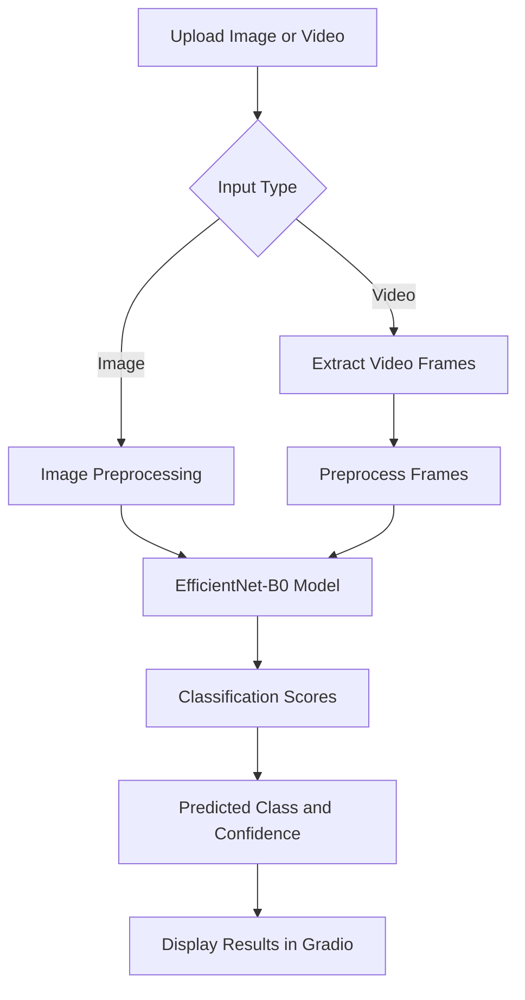

# 🧠 AI-Based Deepfake Detection System

**An AI-powered deepfake detection system that analyzes images and videos using deep learning to identify potentially manipulated or AI-generated visual content.**

Built using **EfficientNet-B0, PyTorch, OpenCV, and Gradio**, this project provides an interactive interface for analyzing visual media and generating prediction confidence scores.

  
  
  
  
  

## 📖 Overview

With the increasing accessibility of generative AI, manipulated images and synthetic videos have become more difficult to distinguish from authentic media.

The **AI-Based Deepfake Detection System** aims to address this challenge by applying deep learning and computer vision techniques to classify uploaded visual content.

The system uses **EfficientNet-B0**, a convolutional neural network (CNN), to extract visual features and predict whether an input image belongs to one of the classes supported by the trained model.

For video analysis, OpenCV can be used to process video frames and apply the image-classification pipeline.

The application presents the prediction and its associated confidence score through a simple, interactive Gradio interface.

### 🎯 Project Objectives

- Develop a deep learning-based approach to deepfake image detection.
- Extend the detection workflow to video inputs.
- Present prediction results and confidence scores through an intuitive interface.
- Optimize inference for practical use.
- Make the application accessible through web-based deployment.

---

## ✨ Key Features

| Feature | Description |
|---|---|
| 🖼️ Image Detection | Analyze uploaded images using the trained deep learning model. |
| 🎥 Video Detection | Process video content and analyze frames for potential manipulation. |
| 📊 Confidence Score | Display the model's prediction confidence. |
| 🧠 Deep Learning | Use EfficientNet-B0 for visual feature extraction and classification. |
| ⚡ Optimized Inference | Apply inference optimizations where supported by the implementation. |
| 🌐 Interactive Interface | Provide an easy-to-use interface using Gradio. |
| ☁️ Cloud Deployment | Make the application accessible through Hugging Face Spaces. |

---

## ⚙️ How It Works

The system follows a visual-media classification pipeline.

1. **Input:** The user uploads an image or video.
2. **Preprocessing:** The input is prepared for model inference. Video inputs are processed into frames when supported by the video pipeline.
3. **Feature Extraction:** EfficientNet-B0 extracts relevant visual features.
4. **Classification:** The trained classification head generates scores for the model's supported classes.
5. **Prediction:** The application selects a predicted class from the model output.
6. **Result Display:** Gradio displays the prediction and corresponding confidence score.

### Workflow

*Note: The diagram describes the intended processing workflow. Actual video aggregation and classification behavior depend on the implemented inference pipeline.*

---

## 🧠 Model Architecture

### EfficientNet-B0

EfficientNet-B0 is a convolutional neural network designed to balance computational efficiency and model accuracy. It uses compound scaling to balance network depth, width, and input resolution.

In this project, the model is used for visual feature extraction and deepfake classification.

**Model details**

- **Architecture:** EfficientNet-B0
- **Framework:** PyTorch
- **Task:** Image classification
- **Output:** Predicted class and confidence score
- **Classification:** Softmax-based probabilities, if configured in the inference pipeline
- **Dataset:** Deepfake image datasets used during training

### Prediction Process

For a model that outputs logits \(z\), the softmax function converts the class scores into normalized probabilities:

\[
P(y=i\mid x)=\frac{e^{z_i}}{\sum_j e^{z_j}}
\]

The predicted class is selected from the resulting class probabilities.

**Important:** A high confidence score indicates the model's confidence in its prediction, not a guarantee that the prediction is correct. Softmax confidence is not necessarily a calibrated probability of authenticity.

---

## 🛠️ Technology Stack

| Technology | Purpose |
|---|---|
| Python | Core programming language |
| PyTorch | Deep learning model development and inference |
| EfficientNet-B0 | Visual feature extraction and classification |
| OpenCV | Video processing and frame extraction |
| Gradio | Interactive web application |
| Hugging Face Spaces | Application hosting and deployment |

---

## 🚀 Getting Started

Follow these instructions to run the project locally.

### Prerequisites

Make sure the following are installed:

- Python 3.10 or a compatible version supported by your dependencies
- Git
- pip
- A compatible PyTorch environment

---

## ⭐ Support

If you find this project interesting, consider giving the repository a ⭐ on GitHub.

Contributions, suggestions, and feedback are welcome!

**Disclaimer:** This project is intended for educational and research purposes. Its predictions should not be used as the sole basis for determining the authenticity of media.

## Screenshots (Demo)

---

